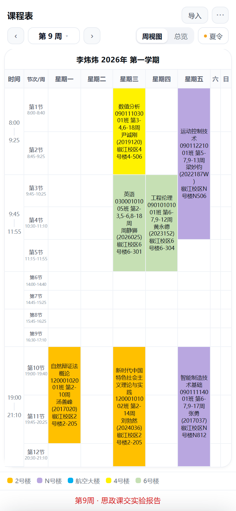
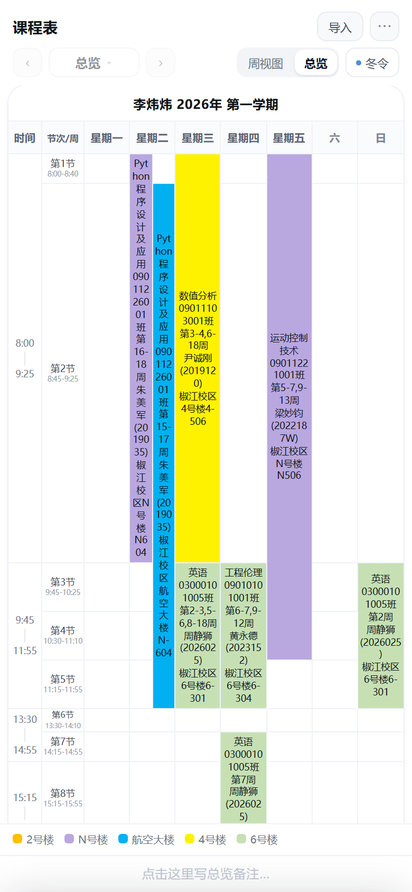
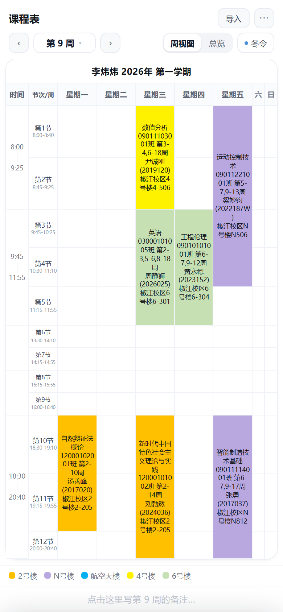
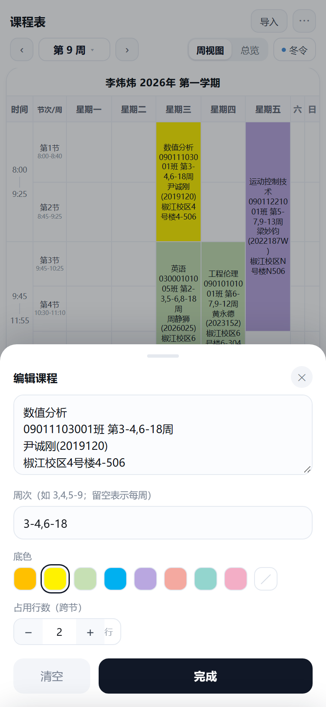
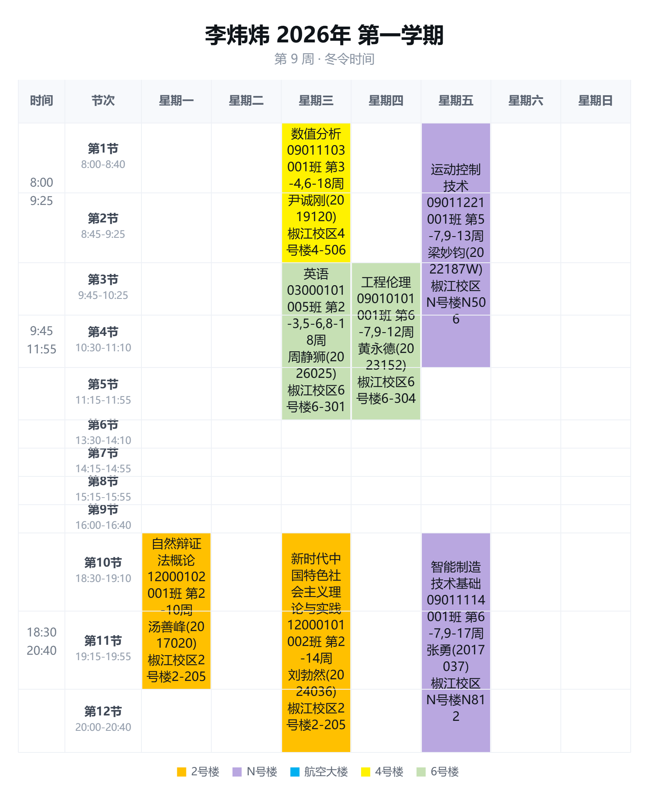
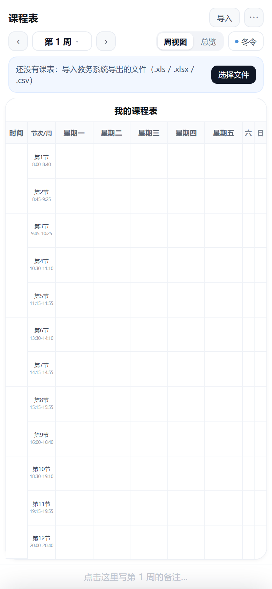

# 📅 课程表 v2.0

把教务系统导出的课表（`.xls` / `.xlsx` / `.csv`）丢进去，自动排成手机课表：**按周查看、总览全学期、夏令/冬令切换、一键生成图片**。单页应用 + PWA，装到桌面像 App，断网可用。



---

## 相比 v1.0 的变化

| | v1.0 | v2.0 |
|---|---|---|
| 数据来源 | 手动逐格填 | **导入教务表自动填** |
| 周次 | 只有一张静态表 | **按周查看 + 总览**，可自由选周 |
| 时间 | 固定时间 | **夏令/冬令一键切换**（第 6 节起 +30 分钟） |
| 导出 | JSON 备份 | **生成 PNG 图片** |
| 备份 | 导出/导入 JSON | 取消（数据存本机，换设备重新导入即可） |

## 功能

- **一键导入**：读教务导出的表格，自动识别星期表头、节次行、周次、班级、教师、地点，并**按上课地点配色**填好
- **同楼同色**：颜色跟着「楼」走（如 2号楼一色、N号楼一色），底部有颜色图例；改错了可以「⋯ → 按上课地点重新配色」，单独某门课也可以手动改成**无色**
- **按周查看**：`‹ 第 9 周 ›` 翻看，或点「第 N 周」直接选周（有课带黄点、有备注带红点）
- **每周备注**：底部备注栏一直显示，点一下就能给**当前这一周**写提醒，切周自动跟着换
- **总览**：一屏看完整学期；同一格有多门课（不同周次）时上下堆叠、各用自己的颜色
- **夏令 / 冬令**：左下角一键切换，第 6~12 节整体推迟 30 分钟
- **生成图片**：把当前视图（周视图或总览）画成一张 PNG，带标题和图例，直接发给同学
- **可编辑**：点任意课程改文字、周次、底色、跨节数；点空格可以加课
- **离线可用**：PWA，装到主屏幕后断网也能打开

| 总览 | 冬令 | 编辑 |
|---|---|---|
|  |  |  |

「生成图片」导出的样子（带标题、周次、楼栋图例）：



首次打开是一张空课表，顶部会提示导入：



---

## 怎么用

1. 打开页面 → 点「导入」或顶部提示条里的「选择文件」
2. 选教务系统导出的 `学生课表.xls`
3. 自动跳到「本学期第 N 周」（按「⋯ → 开学第一周的周一」和今天算）
4. 上方切「周视图 / 总览」，点「夏令」可切冬令
5. `⋯ → 生成图片` 导出当前视图

### 表格格式要求

程序靠这两点识别，教务系统导出的原表直接就能用：

- 表头行包含 **`星期一` … `星期日`**（列的位置不限，星期几就对应哪一列）
- 第一列是 **`第1节` … `第12节`**（行可以重复，比如原表把它按天分成几段排）

单元格内容按这个规律解析：

```
课程名称 班级 第16,17,18周 教师(工号) 地点
```

- 周次支持 `第7周`、`第16,17,18周`、`第3-9周`
- 同一格里有多门课时用 `|` 分隔（原表就是这样）
- 连续的相同节次会自动合并成一门课（比如第 3~5 节）

### 颜色怎么分

颜色按 **上课地点里的「楼」** 来分：`椒江校区4号楼4-506` → `4号楼`，`椒江校区N号楼N604` → `N号楼`，`椒江校区航空大楼N-604` → `航空大楼`。
同一栋楼的所有课都用同一个颜色，按楼名排序后依次取色；没有楼的信息就归到「其它」。
底部那条就是颜色图例；想重排就「⋯ → 按上课地点重新配色」。
单个课程也能手动换色，色板最后一个「斜线」格子是**无色**（白底黑字）。

## 部署到 GitHub Pages

1. 新建仓库，把本目录文件全部上传（含 `vendor/`、`icons/`、`docs/`）
2. **Settings → Pages** → Source 选 `Deploy from a branch`，分支 `main`、目录 `/ (root)`
3. 等 1 分钟，访问 `https://<用户名>.github.io/<仓库名>/`
4. 手机上打开后：iPhone 用 Safari「分享 → 添加到主屏幕」，Android 用 Chrome「菜单 → 安装应用」

> `index.html` 必须在根目录；`manifest.json`、`service-worker.js`、`vendor/` 也要一起传。
> 改了内容想强制更新缓存，把 `service-worker.js` 里的 `VERSION` 改一下。

## 数据说明

课表、周次、季节选择都存在浏览器本地（localStorage），**只在这台设备的这个浏览器里有效**：

- 换设备 / 换浏览器 / 清缓存 → 重新导入一次表格即可
- 换手机不用导 JSON，直接再导一遍教务表更快

## 文件说明

```
index.html             主程序
manifest.json          PWA 清单
service-worker.js      离线缓存
vendor/xlsx.full.min.js 表格解析库（SheetJS，支持 xls/xlsx/csv）
icons/                 应用图标
docs/                  README 截图
```

## 夏令 / 冬令时间表

第 1~5 节两季相同；**夏令从第 6 节起整体推迟 30 分钟**（午休更长），冬令更早。

| 节次 | 冬令 | 夏令 |
|---|---|---|
| 1 | 8:00-8:40 | 8:00-8:40 |
| 2 | 8:45-9:25 | 8:45-9:25 |
| 3 | 9:45-10:25 | 9:45-10:25 |
| 4 | 10:30-11:10 | 10:30-11:10 |
| 5 | 11:15-11:55 | 11:15-11:55 |
| 6 | 13:30-14:10 | **14:00-14:40** |
| 7 | 14:15-14:55 | **14:45-15:25** |
| 8 | 15:15-15:55 | **15:45-16:25** |
| 9 | 16:00-16:40 | **16:30-17:10** |
| 10 | 18:30-19:10 | **19:00-19:40** |
| 11 | 19:15-19:55 | **19:45-20:25** |
| 12 | 20:00-20:40 | **20:30-21:10** |

默认按日期自动选：**10 月 8 日 ~ 4 月 30 日算冬令**，其余夏令；点一下顶部按钮可随时切换，选择会被记住。

## 许可

[MIT](LICENSE)，随便用、随便改。

### 更新记录

- **v2.3** — 周六、周日两列等宽（都没课就一起收成细条）；色板新增「无色」选项。
- **v2.2** — 修正夏令/冬令时间（夏令第 6 节起更晚）；周六/周日只显示「六」「日」、无课时收缩；底部备注栏常显，改成**按周备注**；周次选择里对有备注的周加红点。
- **v2.1** — 课程颜色改为**按上课地点（楼栋）区分**，同楼同色，底部新增颜色图例，图片里也带图例；新增「按上课地点重新配色」。
- **v2.0** — 导入教务表格自动生成课表；按周查看 + 总览；夏令/冬令切换；导出 PNG 图片；取消 JSON 备份。
- **v1.0** — 手填式课表：可编辑单元格、底色、跨节合并、自动时间段、空行压缩、周次自动计算、JSON 导入导出。
